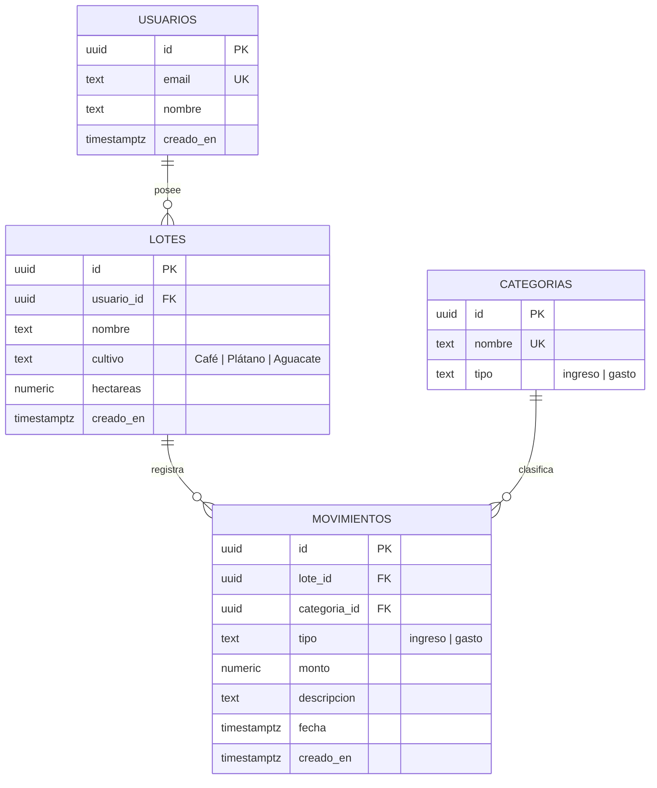
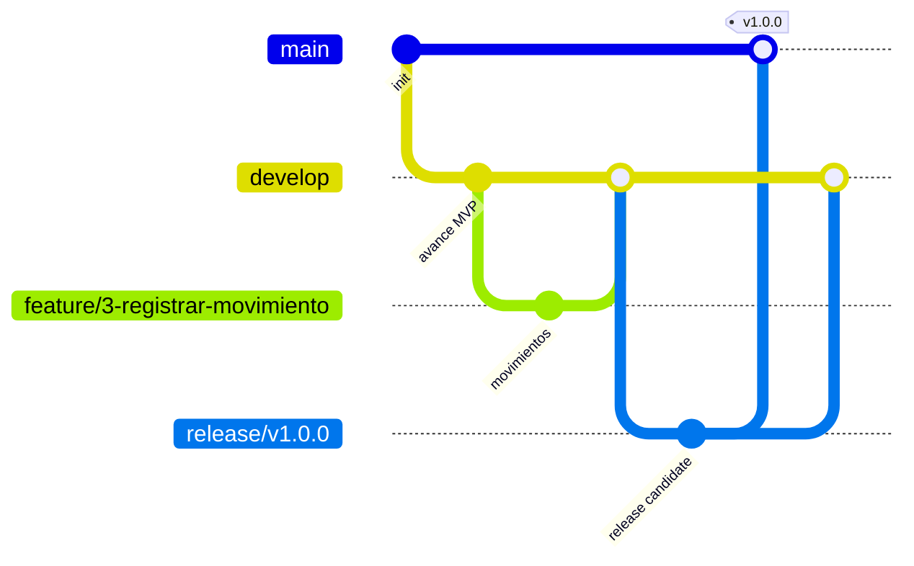

# AgroControl

**MVP de control financiero y asesoría con IA para cultivos de café, plátano y aguacate.**

AgroControl es una aplicación móvil Android que permite al pequeño y mediano productor registrar sus lotes de cultivo, llevar un libro de caja sencillo (ingresos y gastos por lote) y consultar un asesor agrícola inteligente especializado en café, plátano y aguacate. La persistencia y la autenticación se gestionan con `Supabase` (PostgreSQL + Auth con `JWT`), y la analítica del negocio se publica en `Looker Studio`.

---

## Índice

1. [Descripción de la solución](#1-descripción-de-la-solución)
2. [Stack tecnológico](#2-stack-tecnológico)
3. [Esquema de agentes y skills](#3-esquema-de-agentes-y-skills)
4. [Instrucciones de instalación](#4-instrucciones-de-instalación)
5. [Diccionario de datos / Modelo ER](#5-diccionario-de-datos--modelo-er)
6. [Enlace al dashboard](#6-enlace-al-dashboard)
7. [Estrategia de ramas y contribución](#7-estrategia-de-ramas-y-contribución)

---

## 1. Descripción de la solución

### Problema que resuelve

Los pequeños y medianos productores agropecuarios colombianos trabajan con muy poca información financiera: los ingresos por venta de cosecha y los gastos de producción (abonos, jornales, fungicidas, etc.) se anotan en cuadernos, no se asocian a un lote específico y no permiten saber si un cultivo está generando ganancia o pérdida. A esto se suma que el acceso a asesoría técnica de calidad (dosis de fertilización, manejo de plagas como la roya, calendarios de siembra) es limitado, tardío o costoso.

### Público objetivo

- Pequeños y medianos **caficultores**.
- Productores de **plátano**.
- Productores de **aguacate**.

### Alcance del MVP

| Funcionalidad | Descripción |
|---|---|
| **Registro básico de lotes** | Cada lote tiene un nombre, un cultivo (`Café`, `Plátano` o `Aguacate`) y una cantidad de hectáreas. |
| **Libro de caja simple** | Registro únicamente de **ingresos** (ventas de cosecha) y **gastos** (abonos, jornales, fungicidas, etc.) asociados a cada lote, con cálculo del saldo actual. |
| **Asistente IA directo** | Un chat conectado a una API de IA con un prompt especializado que responde exclusivamente dudas técnicas sobre estos tres cultivos (por ejemplo, dosis de NPK en floración o control de la roya). |
| **Autenticación** | Registro e inicio de sesión con `JWT` mediante `Supabase Auth`; todas las rutas sensibles quedan protegidas y el token se valida en cada petición. |

### Pantallas previstas

1. **Listado de lotes:** tarjetas por lote con balance (gastos vs. ingresos) y botón **"Agregar Nuevo Lote"**.
2. **Detalle del lote:** historial de movimientos y botón **"Registrar Movimiento"** (tipo Gasto/Ingreso, categoría, monto y descripción).
3. **Asesor Agrícola IA:** chat de consulta técnica especializada.

### Flujo de ejemplo

1. El usuario crea el lote **"Lote La Albania"** de tipo `Café`.
2. Registra un **gasto de $300.000 COP** en la categoría **"Fertilizante"**.
3. Ve reflejado su balance en **-$300.000 COP** en la tarjeta del lote y en su detalle.
4. Consulta al asesor IA sobre **control de la roya** y recibe una respuesta técnica contextualizada.

### Fuera de alcance del MVP

- Gestión multi-usuario por organización o rol (administrador, operario, contador).
- Contabilidad formal, generación de libros legales o facturación electrónica.
- Georreferenciación de lotes, imágenes satelitales o pronósticos del clima.
- Modo offline completo y sincronización diferida.
- Marketplace, pasarela de pagos o comercio entre productores.

---

## 2. Stack tecnológico

| Categoría | Tecnología | Función en el proyecto | Estado |
|---|---|---|---|
| IDE | Android Studio `[VERSION_ANDROID_STUDIO]` | Desarrollo, depuración y despliegue de la app. | Por completar |
| Lenguaje | Java 11 | Lenguaje principal de la aplicación Android. | Definido |
| Build system | Gradle Kotlin DSL (`build.gradle.kts`) | Gestión de dependencias y compilación (`compileSdk 36`, `minSdk 24`). | Definido |
| UI | AndroidX + Material Design | Componentes visuales, temas y tarjetas (`MaterialCardView`). | Definido |
| Navegación | Jetpack Navigation Component | Navegación entre las 3 pantallas del MVP (fragments + `nav_graph.xml`). | Definido |
| Vinculación de vistas | ViewBinding | Acceso tipado a las vistas de cada pantalla. | Definido |
| Backend / BaaS | `Supabase` | Base de datos `PostgreSQL` gestionada, autenticación y políticas RLS. | Por integrar |
| Persistencia | `PostgreSQL` (vía Supabase) | Modelo relacional normalizado de usuarios, lotes, categorías y movimientos. | Por integrar |
| Autenticación | `Supabase Auth` (`JWT`) | Registro e inicio de sesión; el `JWT` emitido se adjunta a cada petición y las políticas RLS validan la sesión en cada consulta. | Por integrar |
| Cliente HTTP | `[CLIENTE_HTTP]` (p. ej. Retrofit + OkHttp o Volley) | Peticiones REST a Supabase (PostgREST) y a la API de IA. | Por decidir |
| Manejo de `JWT` | `[LIB_JWT_ANDROID]` (p. ej. `java-jwt` de Auth0 o manejo nativo del token de Supabase) | Decodificación/validación del token en el cliente y control de sesión expirada. | Por decidir |
| Cliente de API de IA | `[PROVEEDOR_IA]` + `[SDK_IA]` (p. ej. OpenAI) | Chat del asesor agrícola con prompt especializado en café, plátano y aguacate. | Por integrar |
| Analítica | `Looker Studio` | Dashboard con KPIs financieros, gráficos y filtros sobre los datos de Supabase. | Por integrar |
| Control de versiones | Git + GitHub | Repositorio del equipo con `GitFlow` y Pull Requests. | Definido |
| Asistencia con agentes | `OpenCode` | Entorno de desarrollo asistido por agentes especializados (ver sección 3). | Definido |

> **Nota sobre autenticación:** este MVP no utiliza servidor intermedio propio. La validación del `JWT` en cada petición se resuelve con `Supabase Auth` (token firmado por Supabase) y con **políticas RLS** en `PostgreSQL`, de modo que cada consulta solo devuelve o modifica las filas del usuario autenticado (`auth.uid()`).

---

## 3. Esquema de agentes y skills

El proyecto se desarrolla en `OpenCode` con una arquitectura de **agentes especializados**. Estos **son todos los agentes del equipo** y cada integrante debe replicar exactamente la misma definición (ver sección 4).

### Agentes del equipo

| Agente | Responsabilidad |
|---|---|
| **Interrogador** | Recopila y aclara requisitos con el usuario/productor: levanta dudas de alcance, valida el flujo "Lote La Albania" y redacta los criterios de aceptación antes de escribir código. |
| **Arquitecto** | Define la arquitectura técnica: modelo relacional de `Supabase` (tablas, FK, índices, RLS), esquema de autenticación con `JWT` y decisiones de integración con la API de IA. |
| **Diseñador** | Diseña la experiencia de las 3 pantallas (listado de lotes con tarjetas y balance, detalle con historial y "Registrar Movimiento", chat del asesor IA), paleta, navegación y estados vacíos/carga/error. |
| **Planeador** | Convierte arquitectura y diseño en un plan de trabajo ejecutable: desglose en tareas, prioridades, ramas `feature/*` correspondientes y estimaciones por integrante. |
| **Constructor** | Implementa el código: pantallas Android (Java + ViewBinding + Navigation), llamadas a Supabase/Auth/IA, SQL del esquema y políticas RLS. |
| **Probador** | Escribe y ejecuta pruebas (JUnit unitarias y Espresso de instrumentación), verifica el flujo completo (crear lote → registrar gasto → ver saldo → consultar IA) y reporta defectos. |
| **Revisor** | Revisa los Pull Requests: estilo, seguridad (no exponer claves, validación de `JWT`), cumplimiento de la rúbrica y calidad del modelo de datos; da el visto bueno antes del merge. |
| **Liberador** | Gestiona `GitFlow`: prepara ramas `release/*`, etiquetas, notas de versión y coordina el merge a `main`/`master`; valida que el dashboard y la documentación estén listos para la entrega. |
| **Guardián** | Vigila la salud del proyecto a lo largo del tiempo: monitorea el `.gitignore`/`.env`, la consistencia de la configuración de `OpenCode` entre integrantes, la validez del esquema SQL y las credenciales de `Supabase`/`Looker Studio`. |

### Coordinación entre agentes

El flujo por cada entrega es secuencial con puntos de revisión:

```
Interrogador (requisitos y criterios)
      ↓
Arquitecto + Diseñador (specs técnicas y de UX)
      ↓
Planeador (tareas, prioridades y ramas feature/*)
      ↓
Constructor (implementación)
      ↓
Probador (pruebas y reporte de defectos)
      ↓
Revisor (visto bueno del Pull Request)
      ↓
Liberador (release a main/master + etiqueta)
      ↓
Guardián (auditoría transversal continua en todas las fases)
```

### Skills instaladas

Skills de `OpenCode` requeridas para trabajar con el stack del proyecto:

| Skill | Justificación |
|---|---|
| `[SKILL_ANDROID]` (p. ej. Android/Gradle) | Ayuda a generar `build.gradle.kts`, fragments, ViewBinding y Navigation según las buenas prácticas de AndroidX. | 
| `[SKILL_SQL_POSTGRES]` (p. ej. SQL/PostgreSQL) | Redacción y revisión de DDL, índices y políticas RLS para el esquema de Supabase. |
| `[SKILL_SUPABASE]` | Configuración del cliente Supabase, Auth con `JWT` y operaciones PostgREST. |
| `[SKILL_GIT]` | Uso correcto de `GitFlow`, historial de commits y flujo de Pull Requests. |
| `[SKILL_IA_GEN]` (p. ej. prompt/API de IA) | Integración del chat del asesor agrícola y construcción del prompt especializado. |

> **Nota:** todos los integrantes deben instalar exactamente las mismas skills y versiones, documentando cualquier alta o baja en este apartado.

### Servidores MCP integrados

El flujo del equipo sí requiere servidores MCP para dar contexto real a los agentes:

| Servidor MCP | Uso justificado |
|---|---|
| **`mcp-server-supabase`** `[URL_MCP_SUPABASE]` | Permite a los agentes (Arquitecto, Constructor, Probador, Guardián) inspeccionar el esquema real de la base de datos, ejecutar consultas de prueba contra el proyecto de Supabase y validar que las políticas RLS se comportan como se espera antes de llegar a la app. |
| **GitHub MCP** `[URL_MCP_GITHUB]` | Permite a los agentes (Planeador, Revisor, Liberador, Guardián) leer y crear issues, abrir y revisar Pull Requests, inspeccionar el historial de commits y verificar la participación equitativa de los integrantes sin salir del entorno de `OpenCode`. |

Ambos servidores se declaran en la configuración compartida de `OpenCode` (ver sección 4) y usan credenciales de solo lectura o de alcance mínimo, nunca credenciales de administración.

---

## 4. Instrucciones de instalación

Siga estos pasos en orden para levantar el proyecto en local y replicar la configuración de `OpenCode` de forma homogénea entre todos los integrantes.

### 4.1. Prerrequisitos

1. **JDK 11** o superior instalado (`java -version` para verificar).
2. **Android Studio** `[VERSION_ANDROID_STUDIO]` con SDK Platform `API 36` y un emulador o dispositivo con `minSdk 24`.
3. **Git** instalado y configurado con su usuario de GitHub.
4. **Cuenta en [Supabase](https://supabase.com)** con un proyecto nuevo (anote la **URL del proyecto** y la **anon key**).
5. **Cuenta en [Looker Studio](https://lookerstudio.google.com)** (gratuita) para el dashboard.
6. **`OpenCode`** instalado y autenticado (verifique con `opencode --version`).
7. Acceso a la **API de IA** elegida por el equipo `[PROVEEDOR_IA]` con su respectiva clave.

### 4.2. Clonar el repositorio

```bash
git clone [URL_REPOSITORIO_GITHUB]
cd AgroControl
```

### 4.3. Instalar dependencias y abrir en Android Studio

1. Abra **Android Studio** → *Open* → seleccione la carpeta `AgroControl`.
2. Espere a que Gradle sincronice (`File > Sync Project with Gradle Files`).
3. Verifique la compilación:

```bash
./gradlew build
```

### 4.4. Configurar Supabase

1. Cree un proyecto en Supabase y anote:
   - `SUPABASE_URL`: URL del proyecto (`https://<proyecto>.supabase.co`).
   - `SUPABASE_ANON_KEY`: clave pública del proyecto.
2. Ejecute el esquema SQL propuesto (sección 5) en **SQL Editor** de Supabase: tablas `usuarios`, `lotes`, `categorias` y `movimientos`, sus claves foráneas, índices y políticas RLS.
3. Habilite el proveedor de email en **Authentication > Providers** para registro e inicio de sesión con `JWT`.

### 4.5. Configurar el archivo `.env`

1. Copie el archivo de ejemplo incluido en la raíz:

```bash
cp .env.example .env
```

2. Edite `.env` con sus valores reales:

```env
SUPABASE_URL=[SUPABASE_URL]
SUPABASE_ANON_KEY=[SUPABASE_ANON_KEY]
API_KEY_IA=[API_KEY_IA]
PROVEEDOR_IA=[PROVEEDOR_IA]
```

> **Advertencia de seguridad:** `.env` está listado en `.gitignore` y **nunca** debe subirse al repositorio. Solo se versiona `.env.example` con valores vacíos o de ejemplo. El agente **Guardián** audita periódicamente que no haya claves reales en el historial de Git.

### 4.6. Levantar el proyecto en local

1. Conecte un emulador o dispositivo (`adb devices`).
2. Ejecute la app desde Android Studio (botón *Run*) o por línea de comandos:

```bash
./gradlew installDebug
```

3. Verifique el flujo completo: crear un lote → registrar un gasto → observar el saldo → abrir el chat del asesor IA.

### 4.7. Replicar la configuración de OpenCode de forma homogénea

Todos los integrantes deben usar **exactamente la misma** estructura de carpetas, configuración y definiciones de agentes:

1. **Estructura de carpetas compartida** (creada en la raíz del repositorio):

```text
AgroControl/
├── .opencode/
│   ├── agents/          # definiciones de los 9 agentes
│   │   ├── interrogador.md
│   │   ├── arquitecto.md
│   │   ├── disenador.md
│   │   ├── planeador.md
│   │   ├── constructor.md
│   │   ├── probador.md
│   │   ├── revisor.md
│   │   ├── liberador.md
│   │   └── guardian.md
│   └── skills/          # skills compartidas del equipo
├── .env.example
├── README.md
└── ...
```

2. **Configuración de OpenCode:** sincronice el archivo `opencode.json` de la raíz (agente por defecto, lista de servidores MCP de Supabase y GitHub, y referencias a las skills) con el que publica el equipo `[ARCHIVO_CONFIG_EQUIPO]`.

3. **Variables de entorno:** genere su `.env` local a partir del mismo `.env.example` versionado (paso 4.5). Las credenciales personales de Supabase/Looker Studio se comparten por un canal seguro (p. ej. gestor de contraseñas del equipo), nunca por el repositorio.

4. **Skills:** instale el mismo inventario de skills listado en la sección 3, sin agregar skills personales sin avisar al equipo.

5. **Verificación de homogeneidad (checklist del Guardián):**

   - [ ] Misma estructura de carpetas `.opencode/`.
   - [ ] Mismos 9 agentes definidos.
   - [ ] Mismo `opencode.json`.
   - [ ] Mismo `.env.example` versionado.
   - [ ] Mismas skills instaladas y servidores MCP configurados.

---

## 5. Diccionario de datos / Modelo ER

El modelo relacional normalizado de `PostgreSQL` (en `Supabase`) consta de **4 tablas**.

### 5.1. Tabla `usuarios`

| Columna | Tipo | Restricciones | Descripción |
|---|---|---|---|
| `id` | `uuid` | PK, `NOT NULL`, default `auth.uid()` | Identificador del usuario; se sincroniza con Supabase Auth. |
| `email` | `text` | `UNIQUE`, `NOT NULL` | Correo electrónico del productor. |
| `nombre` | `text` | `NOT NULL` | Nombre completo o nombre de la finca. |
| `creado_en` | `timestamptz` | `NOT NULL`, default `now()` | Fecha de creación de la cuenta. |

### 5.2. Tabla `lotes`

| Columna | Tipo | Restricciones | Descripción |
|---|---|---|---|
| `id` | `uuid` | PK, `NOT NULL`, default `gen_random_uuid()` | Identificador del lote. |
| `usuario_id` | `uuid` | FK → `usuarios(id)`, `NOT NULL` | Propietario del lote. |
| `nombre` | `text` | `NOT NULL` | Nombre del lote (p. ej. "Lote La Albania"). |
| `cultivo` | `text` | `NOT NULL`, CHECK en (`Café`, `Plátano`, `Aguacate`) | Tipo de cultivo. |
| `hectareas` | `numeric(8,2)` | `NOT NULL`, `CHECK (hectareas > 0)` | Cantidad de hectáreas del lote. |
| `creado_en` | `timestamptz` | `NOT NULL`, default `now()` | Fecha de creación. |

**Índices recomendados:**

- `idx_lotes_usuario_id` sobre `lotes(usuario_id)` — búsquedas por propietario (y requisito habitual de RLS).

### 5.3. Tabla `categorias`

Catálogo semilla de categorías de movimientos (ejemplos iniciales: `Fertilizante`, `Jornal`, `Fungicida`, `Abono`, `Venta de cosecha`).

| Columna | Tipo | Restricciones | Descripción |
|---|---|---|---|
| `id` | `uuid` | PK, `NOT NULL`, default `gen_random_uuid()` | Identificador de la categoría. |
| `nombre` | `text` | `UNIQUE`, `NOT NULL` | Nombre visible (p. ej. "Fertilizante"). |
| `tipo` | `text` | `NOT NULL`, CHECK en (`ingreso`, `gasto`) | Tipo de movimiento al que aplica la categoría. |

**Índices recomendados:**

- `idx_categorias_tipo` sobre `categorias(tipo)` — filtrado rápido por tipo.

### 5.4. Tabla `movimientos`

| Columna | Tipo | Restricciones | Descripción |
|---|---|---|---|
| `id` | `uuid` | PK, `NOT NULL`, default `gen_random_uuid()` | Identificador del movimiento. |
| `lote_id` | `uuid` | FK → `lotes(id)`, `NOT NULL` | Lote al que pertenece el movimiento. |
| `categoria_id` | `uuid` | FK → `categorias(id)`, `NOT NULL` | Categoría del movimiento. |
| `tipo` | `text` | `NOT NULL`, CHECK en (`ingreso`, `gasto`) | Tipo de movimiento. |
| `monto` | `numeric(14,2)` | `NOT NULL`, `CHECK (monto > 0)` | Valor en COP (p. ej. `300000`). |
| `descripcion` | `text` | | Detalle libre del movimiento. |
| `fecha` | `timestamptz` | `NOT NULL`, default `now()` | Fecha del movimiento; base de los gráficos temporales. |
| `creado_en` | `timestamptz` | `NOT NULL`, default `now()` | Fecha de registro en el sistema. |

**Índices recomendados:**

- `idx_movimientos_lote_id` sobre `movimientos(lote_id)` — historial por lote.
- `idx_movimientos_fecha` sobre `movimientos(fecha)` — series temporales del dashboard.
- `idx_movimientos_tipo` sobre `movimientos(tipo)` — comparativos ingresos vs. gastos.
- `idx_movimientos_lote_fecha` sobre `movimientos(lote_id, fecha)` — combinación más consultada (historial ordenado).

**Saldo actual de un lote** se deriva en tiempo real:

```sql
SELECT
  COALESCE(SUM(monto) FILTER (WHERE tipo = 'ingreso'), 0)
  - COALESCE(SUM(monto) FILTER (WHERE tipo = 'gasto'), 0) AS saldo
FROM movimientos
WHERE lote_id = :lote_id;
```

**Políticas RLS (resumen):** todas las tablas habilitan RLS y exponen políticas de acceso donde **solo el usuario autenticado (`auth.uid()`) puede leer y modificar sus propios lotes y movimientos**; las categorías son de solo lectura para todos los usuarios autenticados.

### 5.5. Diagrama entidad-relación (Mermaid)



---

## 6. Enlace al dashboard

> ### 📊 **[ENLACE_LOOKER_STUDIO]**
>
> Reemplace el marcador anterior por el enlace real del dashboard publicado en `Looker Studio` con **permisos de visualización** ("cualquier usuario con el enlace" o el dominio del equipo).

### Fuente de datos

- Conector directo de `Looker Studio` hacia `Supabase` (`PostgreSQL`) sobre las tablas `lotes` y `movimientos` `[CONFIG_CONECTOR]`, o dataset derivado (vista/agregación exportada) preparado por el equipo.

### KPIs del dashboard (mínimo 3)

| KPI | Descripción |
|---|---|
| **Saldo total** | Ingresos menos gastos del periodo seleccionado, en COP. |
| **Ingresos vs. gastos del periodo** | Totales acumulados de ambas categorías en el rango de fechas activo. |
| **Nº de lotes activos** | Cantidad de lotes registrados por el usuario. |
| **Gasto promedio por hectárea** | Total de gastos dividido entre hectáreas totales (indicador de eficiencia). |

### Gráficos

- **Temporal:** serie mensual (o semanal) de ingresos y gastos a lo largo del tiempo.
- **Comparativo:** ranking de lotes por ingresos, por gasto y por saldo (barras).
- **Distribución:** gasto total por categoría (pastel o dona: fertilizantes, jornales, fungicidas, etc.).

### Filtros dinámicos

- **Rango de fechas** (control de fechas de Looker Studio).
- **Cultivo** (Café / Plátano / Aguacate).
- **Categoría** de movimiento.
- **Tipo** de movimiento (Ingreso / Gasto).

---

## 7. Estrategia de ramas y contribución

El equipo utiliza **GitFlow** de forma estricta sobre el repositorio en GitHub.

### Ramas

| Rama | Origen | Propósito |
|---|---|---|
| `main` (o `master`) | — | Estado estable y desplegable del MVP. Solo recibe merges de `release/*` y `hotfix/*`. |
| `develop` | `main` | Rama de integración: reúne el avance de todas las features de la siguiente entrega. |
| `feature/*` | `develop` | Una funcionalidad concreta (p. ej. `feature/3-registrar-movimiento`, `feature/7-chat-ia`). Se cierra con Pull Request a `develop`. |
| `release/*` | `develop` | Congela el alcance de una versión para estabilización, pruebas finales y ajustes de documentación; luego se mergea a `main` y a `develop`. |
| `hotfix/*` | `main` | Corrección urgente sobre producción; se mergea a `main` y `develop`. |



### Flujo de Pull Requests con revisión

1. Cree su rama desde `develop`: `git checkout develop && git checkout -b feature/[numero]-[descripcion]`.
2. Commits pequeños y convencionales (p. ej. `feat(lotes): crear tarjetas con balance`).
3. Abra un **Pull Request** hacia `develop` usando la plantilla del equipo, describiendo el cambio, la evidencia de pruebas y el issue que cierra.
4. Asigne al menos **un revisor** (idealmente el agente **Revisor** en la sesión de OpenCode correspondiente).
5. El PR debe quitar **verde**: compilación (`./gradlew build`) y pruebas (unitarias y de instrumentación) sin errores.
6. Tras el visto bueno y al menos una aprobación, haga **squash merge** o **merge commit** a `develop` y borre la rama feature.
7. Cuando el alcance de la entrega esté completo, el **Liberador** abre `release/vX.Y.Z`, ejecuta la QA final y mergea a `main` con etiqueta (`git tag vX.Y.Z`).
8. Cualquier corrección posterior sobre `main` se hace mediante `hotfix/*`.

### Participación equitativa

- Cada integrante debe presentar **commits y Pull Requests propios** a lo largo del historial; se revisan métricas de participación (commits, PRs abiertos y revisados) en la rama `develop`.
- Se espera que cada integrante también **revise PRs de los demás**, no solo abra los suyos.
- Toda tarea relevante queda vinculada a un **issue** para trazabilidad.

### Equipo

| Rol en el proyecto | Integrante |
|---|---|
| Interrogador / Arquitecto | `[NOMBRE_INTEGRANTE]` |
| Diseñador / Planeador | `[NOMBRE_INTEGRANTE]` |
| Constructor / Probador | `[NOMBRE_INTEGRANTE]` |
| Revisor / Liberador / Guardián | `[NOMBRE_INTEGRANTE]` |

---

## Licencia

`[TIPO_LICENCIA]` — por definir por el equipo.

## Contacto

- Repositorio: `[URL_REPOSITORIO_GITHUB]`
- Dashboard: `[ENLACE_LOOKER_STUDIO]`
- Integrantes: `[NOMBRE_INTEGRANTE]`, `[NOMBRE_INTEGRANTE]`, `[NOMBRE_INTEGRANTE]`, `[NOMBRE_INTEGRANTE]`
