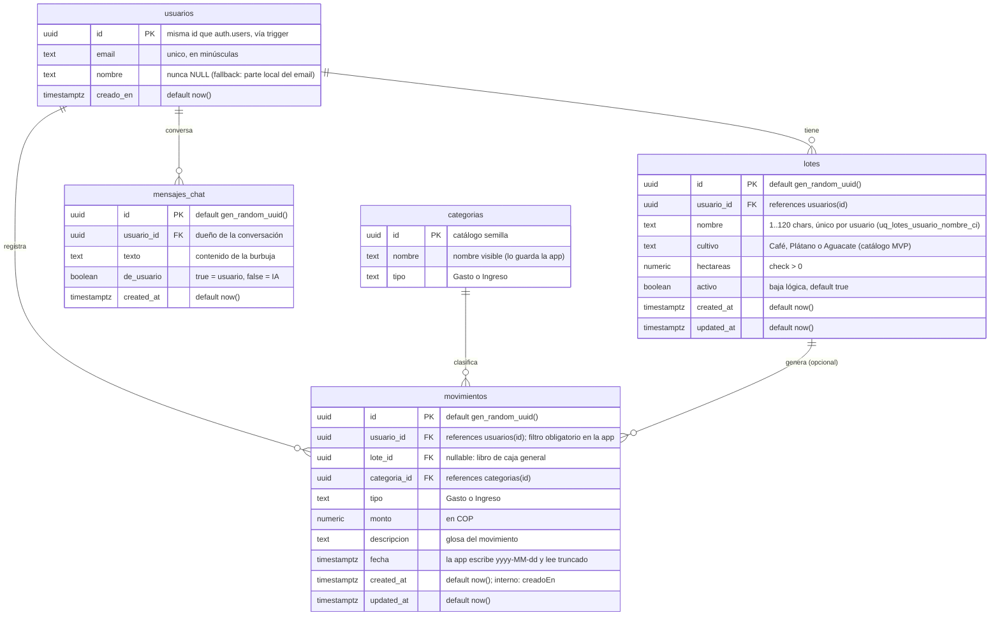

# agrocontrol

**AgroControl** es una aplicación Android para la gestión de predios agrícolas:
registro y seguimiento de lotes de cultivo, libro de caja (ingresos y gastos) y un
asesor agronómico con IA. La persistencia vive en **Supabase** (Postgres + API
REST) y el asistente de IA habla con **Gemini** a través de una Edge Function,
sin que la clave del proveedor llegue nunca al APK.

---

## 1. Descripción de la solución

### Problema que resuelve

Los pequeños y medianos productores de cultivos como café, plátano y aguacate
llevan su operación en cuadernos, hojas de cálculo o de memoria:

- No tienen centralizada la información de sus **lotes** (nombre, cultivo,
  hectáreas, estado).
- No saben cuánto **ganan o pierden**: los ingresos y gastos se registran de
  forma dispersa y no hay un saldo confiable por lote ni del predio completo.
- No tienen a mano **asesoría técnica** cuando aparece una plaga o una
  enfermedad; la decisión suele tomarse a ciegas o tarde.

### Solución

Una app móvil con cuatro pantallas (pestañas inferiores):

| Pantalla | Qué resuelve |
|---|---|
| **Inicio** | Resumen del predio y acceso rápido a las demás secciones. |
| **Lotes** | Alta, listado y detalle de lotes (cultivo, hectáreas), con validación de formulario y estado vacío. |
| **Finanzas** | Libro de caja: registrar ingresos/gastos por categoría, saldo = ingresos − gastos, historial por fecha (general o por lote). |
| **Asesor** | Chat con IA (Gemini) para consejos agronómicos prácticos; el historial se persiste en Supabase y el prompt inyecta los lotes del usuario para respuestas personalizadas. |

Además: login/registro con Supabase Auth y Row Level Security para que cada
usuario solo vea sus datos.

### Público objetivo

- **Principal:** pequeños y medianos productores agrícolas (cafeteros,
  plátano, aguacate) que hoy no usan software de gestión.
- **Secundario:** administradores de predio o asesores que necesitan un
  registro rápido de movimientos y un saldo fiable por lote.

---

## 2. Stack tecnológico

### Aplicación móvil (Android)

| Capa | Tecnología | Versión |
|---|---|---|
| Lenguajes | Java (principal) + Kotlin (módulo Asesor IA) | Java 11 (source/target), Kotlin vía soporte integrado de AGP |
| Build | Android Gradle Plugin / Gradle Wrapper | AGP 9.4.1 / Gradle 9.8.1 |
| SDK | compileSdk / minSdk / targetSdk | 36 / 24 / 36 |
| UI | XML Views + Material Components + Navigation Component | Material 1.14.0, Navigation 2.10.2, ConstraintLayout 2.2.2, RecyclerView 1.4.0 |
| Patrón | ViewBinding, Fragments, ViewModel + LiveData, repositorios con callbacks | — |
| Red | `HttpURLConnection` (repositorios) + OkHttp 4.12.0 | — |
| JSON | Gson 2.10.1 / `org.json` | — |
| Async | Kotlinx Coroutines Android | 1.10.2 |
| Tests | JUnit 4.13.2 (unit), Espresso 3.7.0 + androidx.test.ext.junit 1.3.0 (instrumentación) | — |

### Backend y datos

| Componente | Tecnología |
|---|---|
| Base de datos | **Supabase** (PostgreSQL) — proyecto `pyhvhbenqgmgztbkmrgh` |
| API | PostgREST (API REST de Supabase) desde la app |
| Auth | Supabase Auth (signup/login) + trigger `on_auth_user_created` que replica el usuario a `public.usuarios` |
| Seguridad | Row Level Security (políticas MVP) + filtros `usuario_id` en cada query de la app |
| IA | **Supabase Edge Function `asesor-ia`** (Deno/TypeScript) → proxy seguro a **Gemini** (`GEMINI_API_KEY` como secreto de Supabase, modelo configurable vía `GEMINI_MODEL`) |
| BI | **Looker Studio** (dashboard de reportes, ver §6) |

### Herramientas de desarrollo

Android Studio · Git/GitHub (ramas `main`, `develop`, `feature/*`) · Supabase CLI
· **OpenCode** como agente de desarrollo asistido por IA (ver §3).

---

## 3. Esquema de Agentes y Skills (OpenCode)

### Diseño de agentes

El repositorio se trabaja con **OpenCode** abierto en la raíz del proyecto. El
diseño es deliberadamente **simple y homogéneo para todo el equipo**:

- **No hay** archivos `.opencode/`, `opencode.json(c)` ni `AGENTS.md` en el
  repositorio: todos los integrantes obtienen exactamente el mismo entorno de
  agentes y skills con solo abrir OpenCode en la raíz (la configuración global
  `~/.config/opencode/opencode.jsonc` queda vacía salvo por el `$schema`).
- **Agente principal (build):** el que ejecuta las tareas de escritura de
  código: leer/editar archivos, ejecutar `gradlew`, git, y proponer los commits
  (convención `feat/modulo: descripción` usada en el historial).
- **Agente `explore`:** lectura rápida y no destructiva del código (p. ej.
  localizar vistas, rutas de navegación en `nav_graph.xml` o contratos en
  `docs/`) sin consumir contexto de edición.
- **Agente `general`:** tareas multi-paso independientes (p. ej. revisar todos
  los scripts SQL de `supabase/` y cruzarlos con los repositorios de la app).
- **Sub-sesiones en segundo plano:** trabajos paralelos (por ejemplo, revisar
  tests y documentación a la vez) sin bloquear la sesión principal.

### Skills utilizadas

Skills paqueteadas con OpenCode, activadas por descripción cuando la tarea
coincide:

| Skill | Uso en este proyecto |
|---|---|
| `opencode` | Preguntas sobre la propia configuración de OpenCode, agentes, MCP y CLI (base de esta sección). |
| `docs` | Redacción y edición de la documentación compartible del proyecto (`docs/*.md`, este README). |
| `xlsx` | Generación/lectura de planillas (p. ej. exportar movimientos del libro de caja a CSV/XLSX para análisis). |
| `pdf` | Lectura y generación de entregables en PDF (contratos, reportes del curso). |
| `pptx` / `docx` | Entregables de presentación y documento del proyecto final. |
| `report` | Publicación de issues de OpenCode en GitHub con los diagnósticos estándar. |
| `skill-creator` | Creación o ajuste de skills propias del equipo si fuera necesario. |

### Servidores MCP

**No se usa ningún servidor MCP**, y es una decisión de diseño:

- Supabase se consume desde la app por su **API REST (PostgREST)** documentada
  en `docs/contrato-lotes.md`, y desde el desarrollo con la **Supabase CLI** y
  el **SQL Editor** de la consola: no hace falta un servidor intermedio.
- No hay repositorios, trackers ni servicios externos que el agente deba
  consultar en tiempo de ejecución; todo lo necesario (código, `docs/`,
  `supabase/`) está en el repositorio.

Si en el futuro se necesitara, se agrega sin tocar el código:

```bash
opencode mcp add <nombre> --global --url <url-remota>
```

---

## 4. Instrucciones de instalación

### Requisitos previos

| Herramienta | Versión / nota |
|---|---|
| Android Studio | Con SDK Platform 36 instalado (JDK 17 incluido; el proyecto compila con Java 11) |
| Git | Cualquiera |
| Node.js + npm | Solo para instalar la Supabase CLI |
| Cuenta Supabase | Proyecto `pyhvhbenqgmgztbkmrgh` o uno propio |
| OpenCode CLI | Para replicar el entorno de agentes |

### 1. Clonar y levantar la app

```bash
git clone <url-del-repositorio>
cd agrocontrol

# Tests unitarios (sin Android Studio)
./gradlew test          # Windows: .\gradlew.bat test

# APK de depuración
./gradlew assembleDebug
```

O desde Android Studio: **Open** → seleccionar la carpeta `agrocontrol` →
esperar la sincronización de Gradle → **Run ▶** en un emulador o dispositivo con
Android 7.0 (API 24) o superior.

### 2. Base de datos (Supabase → SQL Editor)

Los scripts son **idempotentes** y se ejecutan en este orden (el detalle está
en [`supabase/README.md`](supabase/README.md)):

1. `supabase/registro_usuarios.sql` — tabla `usuarios` + trigger de signup.
2. `supabase/lotes_permisos.sql` — permisos y RLS de `lotes`.
3. `supabase/movimientos_permisos.sql` — permisos y RLS de `movimientos` y `categorias`.
4. `supabase/mensajes_chat_permisos.sql` — crea `mensajes_chat` (historial del chat).

> Sin el script 4 la app funciona, pero la conversación del Asesor se pierde al
> cambiar de pestaña o reiniciar.

### 3. Edge Function `asesor-ia` (IA)

```bash
npm install -g supabase
supabase login
supabase link --project-ref pyhvhbenqgmgztbkmrgh

supabase secrets set GEMINI_API_KEY=<clave-de-google-ai-studio>
supabase secrets set GEMINI_MODEL=gemini-3.5-flash-lite   # opcional
supabase functions deploy asesor-ia
```

Detalles, códigos de error y prueba con `curl` en
[`supabase/functions/README.md`](supabase/functions/README.md).

### 4. Entorno de OpenCode homogéneo

```bash
npm install -g @opencode/cli     # Windows: no hay gestor de paquetes soportado; usa npm
cd agrocontrol
opencode                         # abre el TUI en la raíz del proyecto
/connect                         # conecta el proveedor de modelos (una vez por equipo)
```

Al no existir configuración de proyecto versionada, **cada integrante obtiene
los mismos agentes y skills** descritos en §3. Para que el entorno sea
reproducible basta con:

- Dejar `~/.config/opencode/opencode.jsonc` como `{"$schema": "https://opencode.ai/config.json"}`
  (sin agentes/skills/MCP propios, o los mismos en todos).
- Abrir OpenCode siempre en la **raíz del repositorio** (donde está
  `settings.gradle.kts`), para que encuentre `app/`, `docs/` y `supabase/`.

---

## 5. Diccionario de datos / Modelo ER

Base de datos PostgreSQL en Supabase (`pyhvhbenqgmgztbkmrgh`), esquema `public`.



### Diccionario de datos

**`public.usuarios`** (réplica de `auth.users` vía trigger)

| Columna | Tipo | Descripción |
|---|---|---|
| `id` | uuid PK | Mismo id que `auth.users.id`. |
| `email` | text | Correo en minúsculas, único. Se usa en el login (`GET /rest/v1/usuarios?email=eq.<correo>`). |
| `nombre` | text | Nombre del usuario; nunca NULL. |
| `creado_en` | timestamptz | Alta del registro. |

**`public.lotes`**

| Columna | Tipo | Descripción |
|---|---|---|
| `id` | uuid PK | Identificador del lote. |
| `usuario_id` | uuid FK → `usuarios` | Propietario; la app filtra siempre `usuario_id=eq.<sesión>`. |
| `nombre` | text | Nombre del lote; único por usuario (case-insensitive → 409 si se repite). |
| `cultivo` | text | `Café`, `Plátano` o `Aguacate` (catálogo del MVP). |
| `hectareas` | numeric | Debe ser > 0 (acepta coma o punto decimal). |
| `activo` | boolean | Baja lógica (el listado aún no la filtra). |
| `created_at` / `updated_at` | timestamptz | Orden del listado: `created_at DESC` vía índice `idx_lotes_usuario_created`. |

**`public.categorias`** (catálogo semilla, solo lectura desde la app)

| Columna | Tipo | Descripción |
|---|---|---|
| `id` | uuid PK | Referencia que guarda `movimientos.categoria_id`. |
| `nombre` | text | Nombre visible; la app lo traduce a uuid por (`nombre` + `tipo`). |
| `tipo` | text | `Gasto` o `Ingreso`. |

**`public.movimientos`** (libro de caja)

| Columna | Tipo | Descripción |
|---|---|---|
| `id` | uuid PK | Identificador del movimiento. |
| `usuario_id` | uuid FK → `usuarios` | Dueño; filtro en SELECT y valor fijo en INSERT. |
| `lote_id` | uuid FK → `lotes` (nullable) | `NULL` = libro de caja general (sin lote). |
| `categoria_id` | uuid FK → `categorias` | Categoría del movimiento. |
| `tipo` | text | `Gasto` o `Ingreso` (saldo = ingresos − gastos). |
| `monto` | numeric | Monto en COP. |
| `descripcion` | text | Glosa del movimiento. |
| `fecha` | timestamptz | La app escribe `yyyy-MM-dd` y al leer trunca el timestamptz a `yyyy-MM-dd`. |
| `created_at` / `updated_at` | timestamptz | `created_at` se mapea al campo interno `creadoEn`. |

**`public.mensajes_chat`** (historial del Asesor IA)

| Columna | Tipo | Descripción |
|---|---|---|
| `id` | uuid PK | Identificador de la burbuja. |
| `usuario_id` | uuid | Dueño de la conversación (filtro `usuario_id=eq.<id>`). |
| `texto` | text | Contenido del mensaje. |
| `de_usuario` | boolean | `true` = mensaje del usuario, `false` = respuesta de la IA. |
| `created_at` | timestamptz | Orden de lectura; índice `mensajes_chat_usuario_fecha_idx`. |

### Seguridad (RLS)

Todas las tablas tienen **Row Level Security** habilitada con políticas MVP
(roles `anon` y `authenticated`); la app compensa filtrando siempre por
`usuario_id` en cada consulta y escribiendo el usuario de la sesión en cada
INSERT. La migración definitiva (políticas `to authenticated using
(usuario_id = auth.uid())`) está comentada en los scripts SQL de `supabase/`.

---

## 6. Enlace al Dashboard

Reporte de indicadores en **Looker Studio** (saldo, ingresos/gastos y
comportamiento del libro de caja):

🔗 **[Dashboard AgroControl – Looker Studio](https://datastudio.google.com/reporting/9939a57f-6d7d-4d4a-89cd-d71dadb128be)**

> El enlace está habilitado con **permisos de visualización** para cualquiera
> con el acceso (no requiere edición). Si no ves el reporte, pide acceso al
> equipo del proyecto.

---

## Estructura del repositorio

```
agrocontrol/
├── app/                     # Código fuente Android (Java + Kotlin)
│   └── src/main/java/com/
│       ├── example/agentes/ # Login, lotes, finanzas, navegación
│       └── agrocontrol/app/ # Módulo Asesor IA (ChatViewModel, API, repositorio)
├── docs/                    # Contratos entre integrantes, plan del asistente IA, capturas
├── supabase/                # Scripts SQL, Edge Function asesor-ia y su documentación
├── gradle/                  # Wrapper y catálogo de dependencias (libs.versions.toml)
└── README.md
```

### Documentación relacionada

- [`supabase/README.md`](supabase/README.md) — scripts SQL y orden de ejecución.
- [`supabase/functions/README.md`](supabase/functions/README.md) — Edge Function `asesor-ia`.
- [`docs/contrato-lotes.md`](docs/contrato-lotes.md) — contrato del módulo de lotes.
- [`docs/INTEGRANTE_3_FINANZAS.md`](docs/INTEGRANTE_3_FINANZAS.md) — libro de caja.
- [`docs/plan-asistente-ia.md`](docs/plan-asistente-ia.md) — arquitectura y estado del asistente IA.
